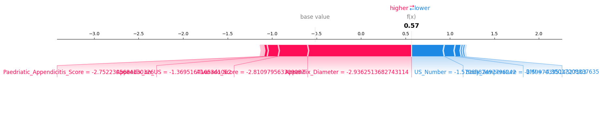

<h1 align="center"> Pediatric Appendicitis Diagnosis</h1>

  <b>Clinical decision support using Machine Learning & Explainable AI</b>

  
  
  
  

---

## ✨ About
This project uses **machine learning** to support the diagnosis of **pediatric appendicitis** from clinical data.  
It combines prediction with **explainable AI**, making the model’s decisions easier to understand.

##  What’s inside
- Data cleaning and preprocessing
- Model training and evaluation
- Prediction app
- SHAP visualizations for interpretation

##  Tech Stack
**Python • Jupyter Notebook • Machine Learning • SHAP**

##  Preview

##  Goal
Build a medical AI tool that is not only accurate, but also **interpretable and useful** in practice.
